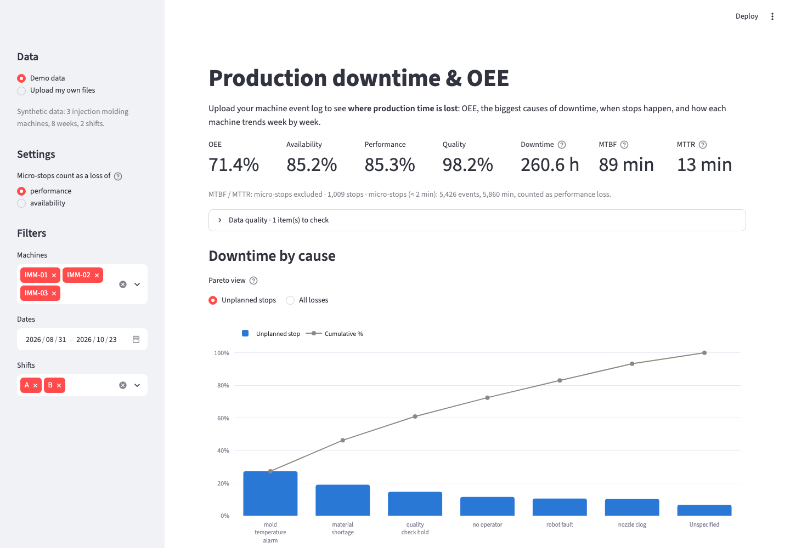
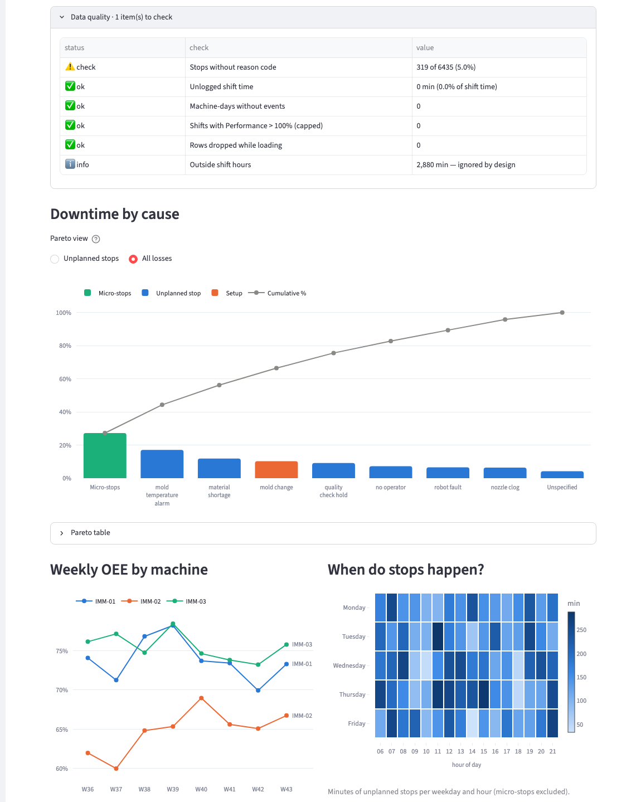
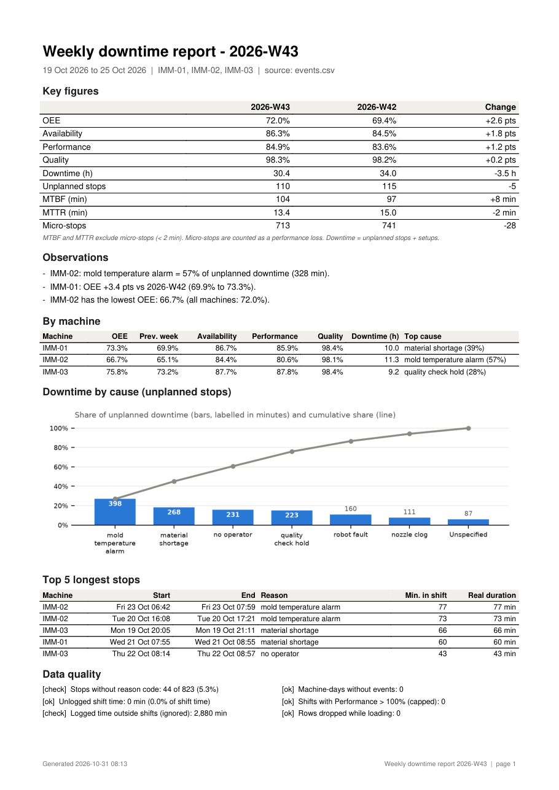
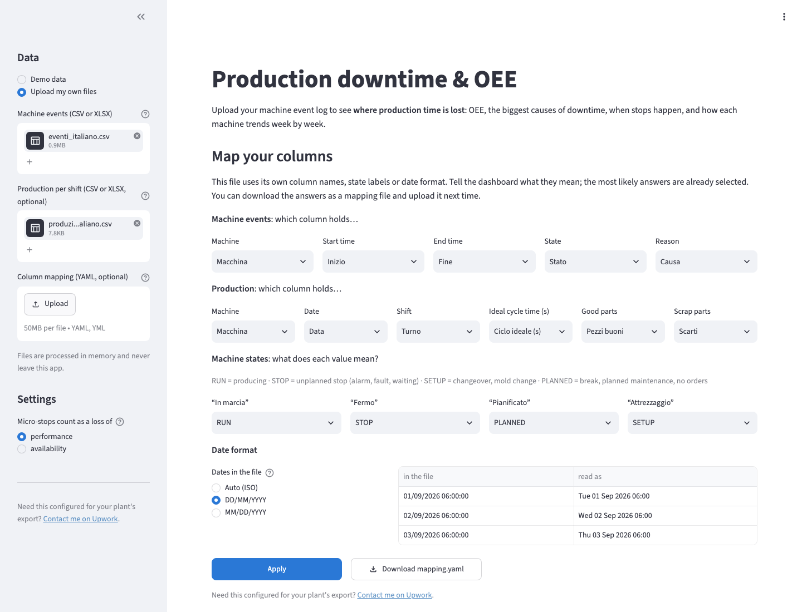

# Production Downtime Report

Turn your machine event log into a clear picture of **where production time is lost**:
OEE, the biggest causes of downtime, when stops happen, and a weekly PDF report
for the production meeting.



## The problem

Most plants already record when machines run and stop: in the MES, in the PLC
historian, or in an Excel sheet filled in by operators. The data is there, but
turning it into answers takes hours every week:

- Which stop causes cost us the most time?
- Is OEE improving, and on which machine?
- Do stops cluster at shift change, on certain hours, on certain days?
- Can we trust the data, or are reason codes missing?

This tool answers those questions from the files you already have, in seconds,
with the same definitions every week.

## Live demo

**[Open the live demo](#)** *(link coming soon)*. It runs on demo data; you can
also upload your own files. Nothing is stored: files are processed in memory.

## Screenshots

| | |
|---|---|
|  |  |
| Data quality checks, all-losses Pareto, weekly OEE per machine, stops by weekday and hour | One-page weekly PDF report |
|  | |
| File problems are listed with their row numbers | |

## What you get

- **Dashboard** (runs in your browser): OEE, Availability, Performance, Quality,
  total downtime, MTBF and MTTR; Pareto of stop causes; weekly OEE trend per
  machine; heatmap of stops by weekday and hour; a filterable list of every stop.
  Filter by machine, date range and shift.
- **Weekly PDF report**: key figures compared with the previous week, three
  automatic observations, KPIs per machine, the Pareto chart, the five longest
  stops and a data quality summary. Observations come from fixed rules and only
  quote computed numbers, for example
  *"IMM-02: mold temperature alarm = 57% of unplanned downtime (328 min)."*
- **Excel workbook** with one sheet per KPI view: by machine, week, day and shift,
  both Pareto views, MTBF/MTTR, micro-stops, every stop, data quality, settings.
- **Data quality checks**: stops without reason code, unlogged shift time, time
  outside shifts, machine-days with no data, shifts with Performance above 100%,
  rows that could not be used.
- **Command line** for scheduled reports, using the same code as the dashboard.

## Use your own data

You need one file with machine events and, for Performance, Quality and OEE,
one with production counts. CSV or Excel; both tables may be sheets of the same
workbook.

**Events**: one row per period in a state.

| machine | start | end | state | reason |
|---|---|---|---|---|
| IMM-01 | 2026-09-01 06:00:00 | 2026-09-01 07:12:30 | RUN | |
| IMM-01 | 2026-09-01 07:12:30 | 2026-09-01 07:20:00 | STOP | nozzle clog |
| IMM-01 | 2026-09-01 07:20:00 | 2026-09-01 10:00:00 | RUN | |
| IMM-01 | 2026-09-01 10:00:00 | 2026-09-01 10:30:00 | PLANNED | break |
| IMM-01 | 2026-09-01 10:30:00 | 2026-09-01 11:15:00 | SETUP | mold change |

States: `RUN`, `STOP` (unplanned), `SETUP` (e.g. mold change), `PLANNED`
(breaks, preventive maintenance, no orders).

**Production**: one row per machine and shift (several rows are fine, e.g. one
per part number).

| machine | date | shift | ideal_cycle_s | good_parts | scrap_parts |
|---|---|---|---|---|---|
| IMM-01 | 2026-09-01 | A | 24 | 861 | 10 |

**Your own column names and labels are fine.** A short mapping file translates
them. This is the mapping for the demo export with Italian headers
([config/mapping.example.yaml](config/mapping.example.yaml)):

```yaml
events:
  sheet: Eventi
  columns: {machine: Macchina, start: Inizio, end: Fine, state: Stato, reason: Causa}
  state_values:
    RUN: In marcia
    STOP: Fermo
    SETUP: Attrezzaggio
    PLANNED: Pianificato
  # datetime_format: "%d/%m/%Y %H:%M"   # if dates are not YYYY-MM-DD HH:MM[:SS]

production:
  sheet: Produzione
  columns: {machine: Macchina, date: Data, shift: Turno, ideal_cycle_s: Ciclo ideale (s),
            good_parts: Pezzi buoni, scrap_parts: Scarti}

shifts:
  A: {start: "06:00", end: "14:00"}
  B: {start: "14:00", end: "22:00"}
  # C: {start: "22:00", end: "06:00"}   # night shifts are supported

micro_stop_minutes: 2
micro_stops_as: performance    # or: availability
unlogged_time: loss            # or: exclude
```

If something in a file is wrong (missing column, unreadable date, end before
start, overlapping events, a state label that is not mapped) you get the full
list of problems with their row numbers, at once.

## KPI definitions

| KPI | Definition |
|---|---|
| Planned production time | Shift time minus PLANNED time (breaks, preventive maintenance) |
| Availability | Run time / planned production time |
| Performance | Ideal cycle time x parts produced / run time; capped at 100% and flagged if higher |
| Quality | Good parts / total parts |
| **OEE** | Availability x Performance x Quality |
| MTBF | Run time / number of unplanned stops |
| MTTR | Unplanned stop time / number of unplanned stops |
| Downtime | Unplanned stops + setups |

How losses are counted (the "six big losses" of OEE):

- **Breakdowns** (unplanned stops) and **setups** (e.g. mold changes) reduce
  Availability. Setups have their own category in the Pareto, so they are not
  mixed up with failures.
- **Small stops**: micro-stops are unplanned stops shorter than 2 minutes
  (adjustable). By default they count as a Performance loss; they can be counted
  against Availability instead. OEE is the same either way. They are excluded
  from MTBF, MTTR and the stop count, and reported separately with their top
  causes.
- **Reduced speed** lowers Performance; **scrap** lowers Quality.
- **Unlogged time** (minutes of a shift with no event at all) counts as lost
  availability by default, shown as "Unlogged" in the all-losses Pareto; it can
  be excluded instead.

Other conventions:

- Events are split at shift boundaries before anything is computed. A stop from
  13:50 to 14:30 adds 10 minutes to the morning shift and 30 to the afternoon
  shift, and counts as one stop, in the shift where it started. Time outside the
  shift calendar (e.g. overnight) is not counted.
- KPIs over several shifts, days or machines are computed from summed minutes
  and parts, never by averaging percentages.
- Stops without a reason code are shown as "Unspecified" and counted in the
  data quality panel.

## Quick start

Python 3.11 (tested; 3.10 or newer should work).

```sh
git clone git@github.com:elfaco2011/production-downtime-report.git
cd production-downtime-report
python -m venv .venv && source .venv/bin/activate
pip install -r requirements.txt

# Dashboard (served on this computer only)
streamlit run app.py --server.address localhost

# Weekly report from the command line (PDF + Excel in output/)
python -m pdr report --input data/sample/events.csv \
    --production data/sample/production.csv --week 2026-W43 --output output/

# Same data exported with other column names: use the mapping
python -m pdr report --input data/sample/plant_export.xlsx \
    --mapping config/mapping.example.yaml --output output/

# Regenerate the demo data
python -m pdr.synth --out data/sample
```

## Limitations

- **No per-machine shift calendar yet.** A shift counts for a machine only if
  the machine logged at least one event in it. Days when a machine logged
  nothing while other machines ran are listed in the data quality panel, but
  not counted in the KPIs.
- The same shift pattern applies to every machine and every day.
- Timestamps are read as local plant time; time zones and daylight-saving
  changes are not handled.
- Dates in text must be `YYYY-MM-DD HH:MM[:SS]` unless a format is set in the
  mapping file. The tool does not guess, so 01/09 is never silently read as
  9 January.
- Performance needs the ideal cycle time on each production row. Values above
  100% are capped and flagged; this usually means the ideal cycle is set too high.
- Micro-stops are identified by duration only, not by cause.
- The dashboard analyses one set of files at a time and keeps nothing between
  sessions.
- The dashboard has no user accounts. Run locally with
  `--server.address localhost` it is reachable from this computer only; a copy
  deployed on Streamlit Community Cloud (choose Python 3.11) is reachable by
  anyone with the link, so use it with sample or anonymised data. Uploaded
  files are kept in memory for the session and never written to disk.

## Development

```sh
pip install -e ".[app,dev]"
pytest
```

The KPI tests use tiny datasets whose expected values are computed by hand and
written in the test, plus checks that the CSV and the mapped Excel export give
identical results.

Every commit is scanned for secrets with [gitleaks](https://github.com/gitleaks/gitleaks).
Git hooks are not versioned, so after cloning install the hook manually:

```sh
brew install gitleaks   # or see the gitleaks install docs for your OS

cat > .git/hooks/pre-commit << 'EOF'
#!/bin/sh
gitleaks git --pre-commit --staged --redact -v || { echo "gitleaks: possible secret, commit blocked"; exit 1; }
EOF
chmod +x .git/hooks/pre-commit
```

If the hook finds a secret, the commit is blocked and the value is redacted in
the output. Remove the secret (move it to `.env`, which is git-ignored) and
commit again.

---

**All data in this repository is synthetic.** Machines, stops and production
figures are generated by `src/pdr/synth.py` with a fixed seed and do not come
from any real plant.
